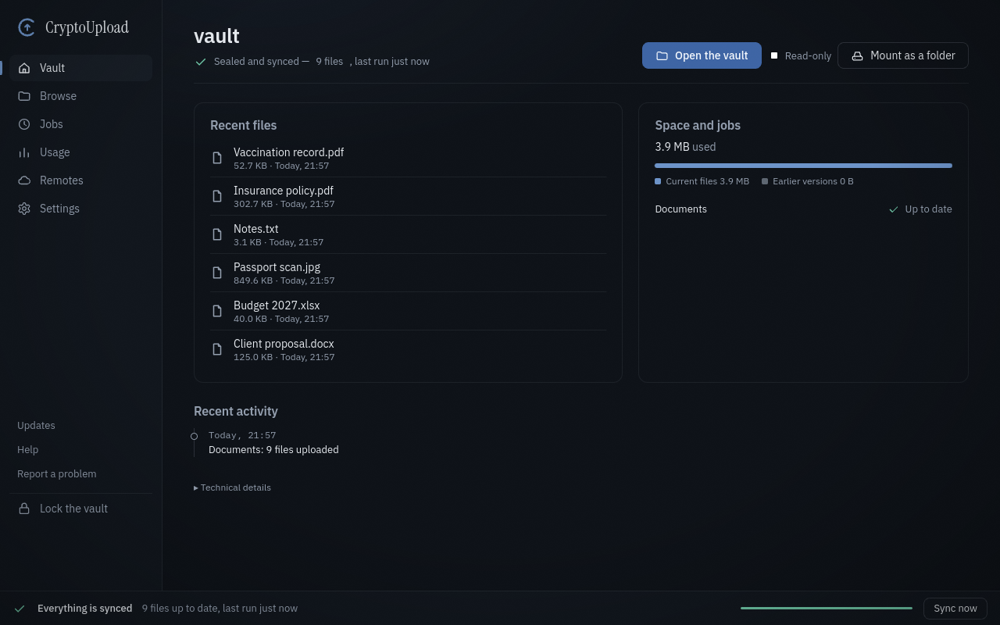
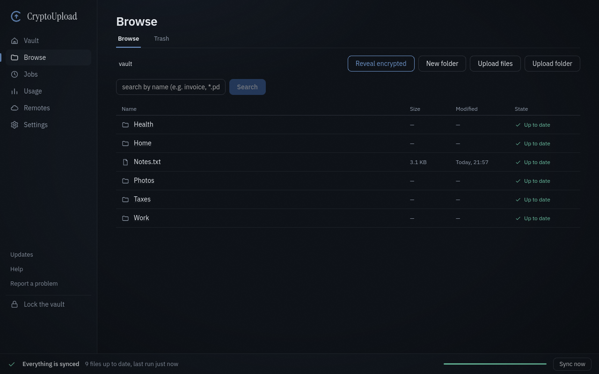
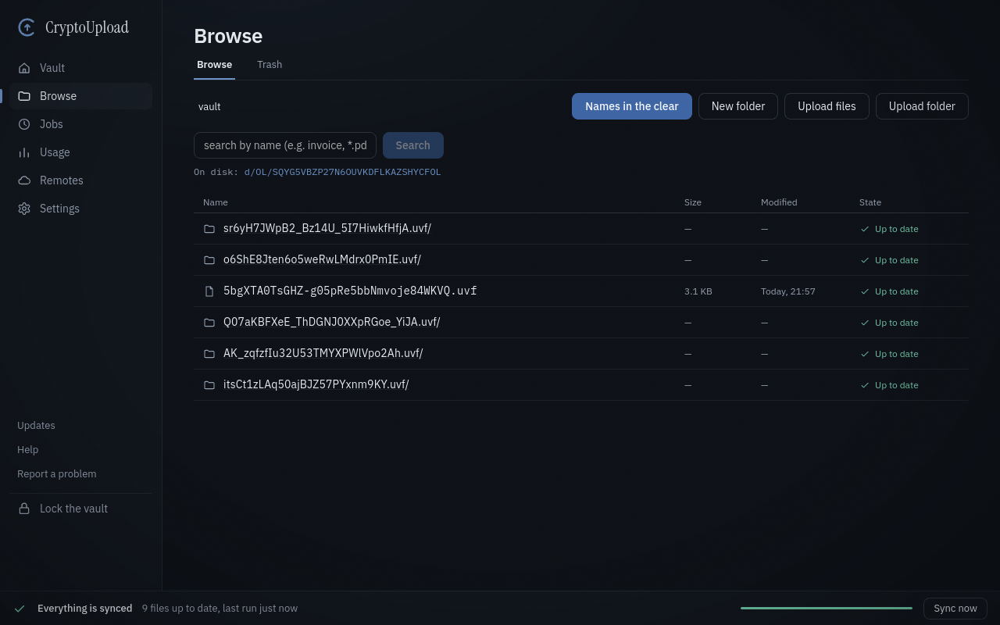
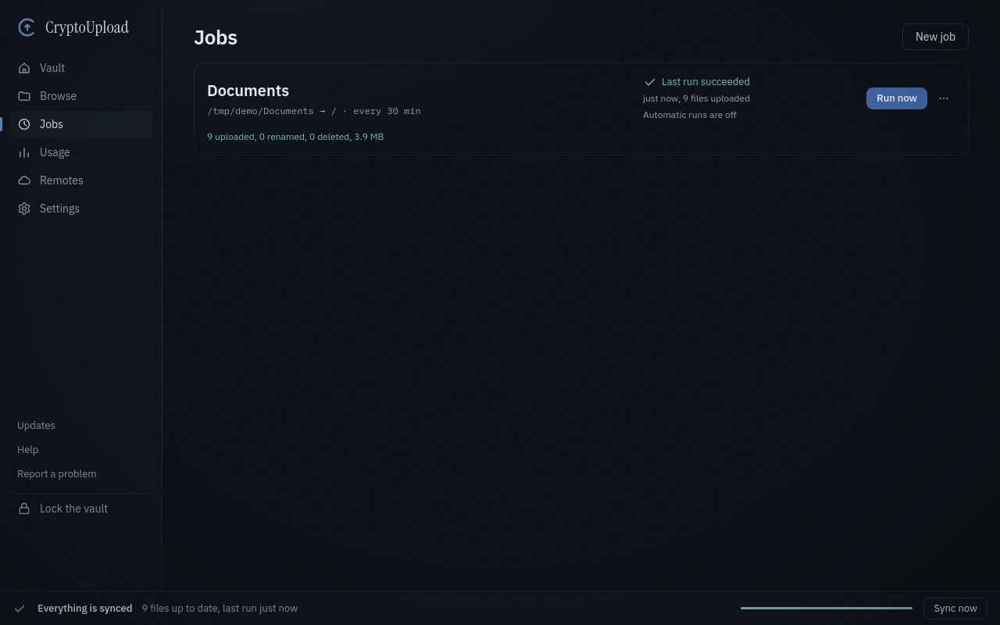

# CryptoUpload

**Your cloud stores your files. It doesn't need to read them.**

CryptoUpload encrypts your files on your Windows or Linux computer, then keeps them on the storage
you already have (Google Drive, an S3 bucket, a NAS, a WebDAV or SFTP server, an external disk), as
an encrypted drive you can open and as an automatic backup with a version history. The provider
only ever stores scrambled data. There is no CryptoUpload server, no account to create and no
telemetry.

[](https://github.com/cryptoupload/CryptoUpload/releases/latest)
[](LICENSE)

[](https://github.com/cryptoupload/CryptoUpload/actions/workflows/ci.yml)

**[Download for Windows or Linux](https://github.com/cryptoupload/CryptoUpload/releases/latest)** ·
[Website](https://cryptoupload.org) · [Connect your storage](docs/PROVIDERS.md) ·
free and open source

> Public beta, not yet independently audited: keep a second copy of anything you can't afford to
> lose, and don't make it the only protection for serious secrets. [What this means](SECURITY.md)

<p align="center">
  
</p>

## Why CryptoUpload

- **Only you can read your files.** Contents and file names are encrypted on your computer before
  anything is uploaded. You unlock the vault with one password; a 24-word recovery phrase on paper
  is your way back in. Keys never leave your device.
- **No sync app in the middle.** CryptoUpload talks to Google Drive, S3, SFTP and WebDAV directly,
  so you don't need your provider's desktop sync app to carry encrypted files back and forth.
- **A drive and a backup in one app.** Open the vault as a normal disk and edit documents in place,
  and keep chosen folders backed up on a schedule, with earlier versions you can bring back.
- **Your storage, no new account.** Use the cloud, bucket or NAS you already pay for. Nothing goes
  through us.

| What you see | What your storage provider stores |
|---|---|
|  |  |

## What you get

- **Seven kinds of storage.** S3 and compatibles (AWS, MinIO, Backblaze B2, Wasabi), SFTP, WebDAV
  (Nextcloud, ownCloud), Google Drive, Dropbox, OneDrive, or a plain local folder or disk.
  [How to connect each one](docs/PROVIDERS.md).
- **Automatic backup and manual upload.** Keep folders backed up on a schedule, or drop in a single
  file. Scheduled backups keep running from the notification area after you close the window.
  Interrupted uploads resume instead of starting again.
- **A drive you can open.** Mount the vault as a disk and work on your documents directly; files
  are decrypted on the fly, even from a vault that lives only in the cloud.
- **History and undo.** Earlier versions of every backed-up file, restore to a point in time, a
  recycle bin, and conflicts that keep both copies instead of guessing which one wins.
- **Limits the damage of ransomware and tampering.** Mass changes are flagged before a backup
  spreads them, S3 Object Lock can make backups undeletable for a period you choose, and an old
  copy of a file presented as the current one is refused.
- **Share a vault without a server.** Give another person access with their own key. Removing them
  changes the vault's keys, so files written afterwards are closed to them.
- **Extra protection when you need it.** A hardware security key (FIDO2) as a true second factor,
  a recovery phrase split into shares, a private vault profile that hides file sizes from the
  provider, decoy files that blur how many files each folder holds, proxy support, a printable recovery
  kit. All off by default; the app explains what each one costs before you turn it on.
- **In your language.** The interface is in 10 languages.

<p align="center">
  
</p>

## Get it

1. Download the installer for your system from the
   [latest release](https://github.com/cryptoupload/CryptoUpload/releases/latest).
2. Run it.

| System | Package |
|---|---|
| Windows 10/11 | `.exe` installer (for your user only, no administrator rights needed) |
| Linux | `.deb` (Debian, Ubuntu) or `.AppImage` (other distributions) |

- **Windows asks for confirmation on first launch.** The beta installer is not yet signed with a
  paid code-signing certificate, so SmartScreen shows "Windows protected your PC": choose
  "More info", then "Run anyway". Updates are checked against the project's signature before they
  are installed.
- **The virtual drive** needs [WinFsp](https://winfsp.dev) on Windows (the installer offers to open
  its download page; installing WinFsp needs administrator rights) and FUSE 3 on Linux. Everything else works without it.
- **Optional: check your download.** Compare the installer's SHA-256 with the one GitHub shows next
  to the file, or with `SHA256SUMS.txt` in the same release. Each installer is also signed with the
  project's key: [how to check it](SECURITY.md#check-a-download). Builds published anywhere else,
  forks included, are not signed by the project.

## Five-minute start

1. Open CryptoUpload; a guided first run explains each step.
2. Create a vault in a local folder or disk, on a NAS (SFTP or WebDAV) or in an S3 bucket, and
   choose a password. Google Drive, Dropbox and OneDrive first need a free app key from your own
   account, a one-time step: [guide](docs/PROVIDERS.md).
3. Write the 24-word recovery phrase on paper and confirm it.
4. Drop files into the vault, or choose a folder to back up automatically.

## Questions

**What can my storage provider still see?** It cannot read the contents or the names of your files and
folders. It can see how many encrypted files and folders there are and how big they are, when they
change, how many people share the vault, that it was made by CryptoUpload, and the internet address
uploads come from. The private vault profile hides exact file sizes and name lengths; decoy files
blur how many files each folder holds; a proxy such as Tor hides your address.

**What if I forget my password?** The 24-word recovery phrase opens the vault. Without either of
them, nobody can open it: there is no server and no copy of your keys anywhere else. (In a
shared vault, the other members can still open it with their own keys.)

**Why do I need my own Google, Dropbox or OneDrive app key?** So that no third party's app sits between you
and your storage: your access depends only on you and your provider.
[Step-by-step guide](docs/PROVIDERS.md).

**Is the vault format tied to this app?** A standard vault uses the openly specified
[Unified Vault Format](https://github.com/encryption-alliance/unified-vault-format), not a format of
our own. A vault created with the private profile adds padding and decoys that only CryptoUpload
reads.

**Is it really free?** Yes, under the GPLv3, with no paid tier and no account.

## Why you can check it instead of trusting it

- **Open source.** All the code is here, under the GPLv3.
- **No home-made cryptography.** The vault uses the open
  [Unified Vault Format](https://github.com/encryption-alliance/unified-vault-format) (AES-256-GCM
  for contents, AES-SIV for names, Argon2id for the password).
- **No telemetry, enforced.** A check in the project's CI fails if any component other than the
  storage backends and the updater gains a network dependency (`cargo run -p xtask -- check-no-http`).
- **Installers built in public.** Every installer on the Releases page is built by this
  repository's GitHub Actions from the published code.

## Known limitations

- **No independent security audit yet.** Do not rely on CryptoUpload as the only protection for
  information whose disclosure would seriously harm you. See [SECURITY.md](SECURITY.md).
- **No macOS or phone app yet.** Phone apps are planned.
- **Dropbox and OneDrive are experimental**: tested against simulated servers, not yet with real
  accounts. Use them for data you also keep elsewhere.
- **Backblaze B2 and Wasabi**: CryptoUpload checks, before saving the remote, that the provider
  refuses to overwrite a file two devices create at the same instant, and refuses the remote with
  an explanation if it does not. The check has not yet run against a real account on these two.
- **Hardware keys (FIDO2)** are tested against a software authenticator; specific physical keys
  may behave differently. Keep your password and recovery phrase.
- **On Windows**, while a vault is unlocked, another program running under your user account may
  be able to read its keys from memory. On Linux the app blocks this (an administrator still can).
- **Scheduled backups need the program running** (window closed is fine, quitting is not). With the
  virtual drive mounted, closing the window quits the program. On GNOME the notification-area
  icon needs the AppIndicator extension.
- **Linux virtual drive**: files are never executable; copy a program out of the drive to run it.
- **Conflict copies carry the computer's name** (the name set in the system, for example
  `report (conflict LAPTOP 2030-01-15 09.15.00 UTC).pdf`). The name stays inside the encrypted vault: the storage
  provider never sees it, but the other members of a shared vault do.
- **Translations**: English is the reference; the other languages are drafts awaiting review by
  a native speaker, and the app says so.

What changed in each release: [CHANGELOG.md](CHANGELOG.md).

## Build from source

```bash
git clone https://github.com/cryptoupload/CryptoUpload.git
cd CryptoUpload/app/apps/desktop
npm ci && npx tauri build
```

Rust stable and Node.js are required. On Linux the build also needs these system packages:
`libwebkit2gtk-4.1-dev libjavascriptcoregtk-4.1-dev libsoup-3.0-dev libgtk-3-dev librsvg2-dev
libayatana-appindicator3-dev pkg-config libudev-dev`.

## Contributing and security

Found a bug or have an idea? Use **Report a problem** in the app's side bar (it prepares the message
and you choose how to send it), or open an issue. Contributions are welcome under the DCO
(sign-off, no CLA): [CONTRIBUTING.md](CONTRIBUTING.md). Report vulnerabilities privately to
**security@cryptoupload.org**, never in a public issue ([SECURITY.md](SECURITY.md)). For
everything else: **info@cryptoupload.org**.

## Licence

[GPLv3](LICENSE) with an
[additional permission for app stores](LICENSE-EXCEPTION.txt).
Copyright © 2026 CryptoUpload.
